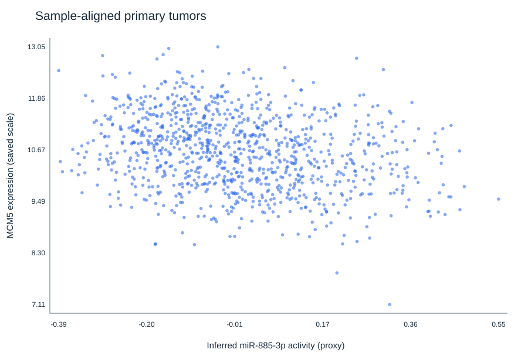
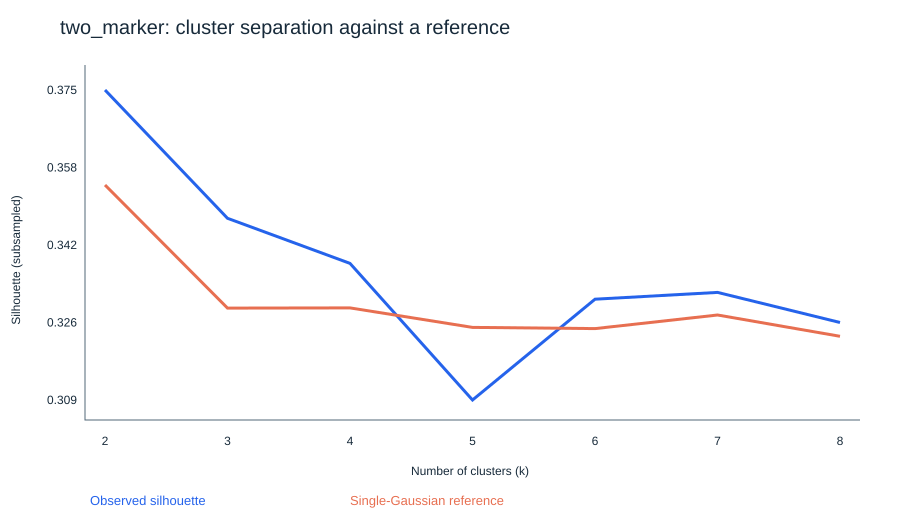

# NSCLC RNA machine learning

**Sahil Patel · an audited continuation of the circRNA research project**

Can expression features motivated by a proposed circFNDC3B–miR-885-3p–MCM5 axis
produce stable, interpretable patterns in primary NSCLC tumors?

This project rebuilds unfinished K-means work on correctly sample-matched data.
It compares two-marker, pathway-only, and combined features using K-means,
Gaussian mixtures, repeated seeds, subsampling, and a single-Gaussian reference.

**Status:** working exploratory benchmark with saved results and tests. No new
clinical subtype or validated diagnostic/survival model is claimed.

## What changed

The old ML spreadsheet paired original-order miRNA proxy scores with independently
sorted MCM5 values. Both historical notebooks also requested 1,000 clusters for
1,000 observations. Those runs are archived, not used as valid results.
The new workflow joins by TCGA ID and analyzes **1,017 primary tumors**.

Read [the original-study audit](https://github.com/sahilnpatel/nsclc-circrna-analysis)
and [the ML audit](docs/ML_AUDIT.md) before interpreting the figures.

## Run the project

Follow [environment setup](docs/ENVIRONMENT.md), then from this repository root:

```bash
python scripts/run_analysis.py
python -m pytest tests -q
# Optional visualization; clustering is never fitted in t-SNE coordinates:
python scripts/run_analysis.py --tsne
```

No downloaded raw matrix is needed for this saved-output analysis. The small,
provenance-tracked inputs are in `data/source`. New score computation is a separate
step in the original-study repository.

## Results

Read [the actual results](results/RESULTS.md) and [machine-readable summary](results/summary.json).
The tested settings favor k=2 for all three feature sets, but silhouettes are close
to those of a single correlated Gaussian. Stable partitions can divide a continuous
cloud: stability alone does not show that distinct biological populations exist.




## Work through this with me

Start with [START_HERE](docs/START_HERE.md), then open
[the guided notebook](notebooks/01_work_through_the_project.ipynb).
Each session has a concrete question, a small code experiment, and an output to
explain. This is intended to be a project you understand and can discuss honestly.

## Files

| Folder | Purpose |
|---|---|
| `archive` | Original notebooks, outputs cleared and local paths redacted |
| `data/source` | Original keyed MCM5, target-score, and pathway exports |
| `data/processed` | Primary tumor features rebuilt by keyed joins |
| `src` | Data checks, modeling, and SVG figure utilities |
| `scripts` | Reproducible experiment entry point |
| `results` | Metrics, assignments, profiles, figures, portable models |
| `notebooks` | Guided executable learning walkthrough |
| `tests` | Alignment, invalid-input, clustering, and model-export checks |
| `docs` | Audit, experimental design, model card, and next tasks |

## Limits that matter

- No direct circRNA or miRNA assay: the miRNA variable is a target-score proxy.
- MCM5 is part of that signature. Leave-MCM5-out recomputation is a priority.
- No clinical subtype, batch, stage, outcome, or independent validation dataset.
- All metrics are exploratory, in-cohort diagnostics; not predictive accuracy.
- Original pathway scores were estimated across the full historical cohort.

[Model card](docs/MODEL_CARD.md) · [references](docs/REFERENCES.md) ·
[credit and rights](docs/RIGHTS_AND_CREDIT.md)
