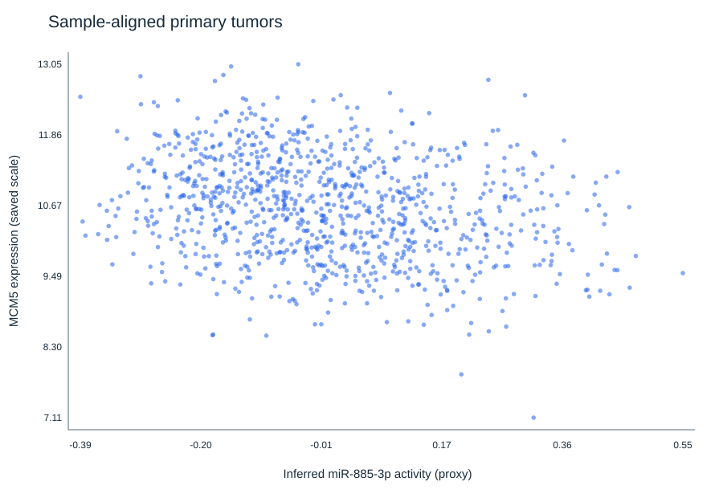
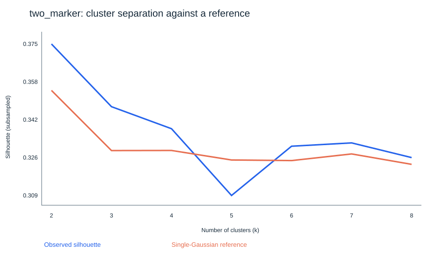
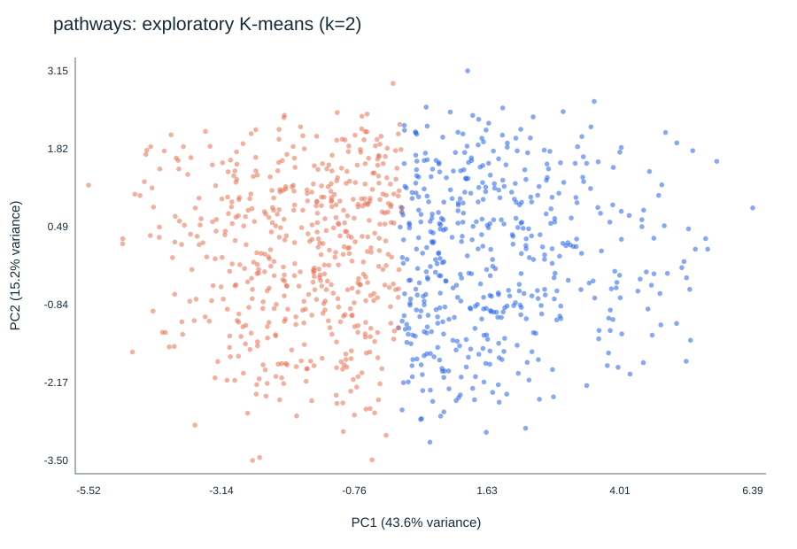

# Exploratory ML results

Run on 1017 sample-ID-aligned primary tumors, seed 52, 8 stability repeats.

| Feature set | Candidate k | Silhouette | Gaussian reference | Subsample stability (ARI) |
|---|---:|---:|---:|---:|
| two_marker | 2 | 0.375 | 0.355 | 0.961 |
| pathways | 2 | 0.235 | 0.228 | 0.969 |
| combined | 2 | 0.206 | 0.201 | 0.939 |

Candidate k maximizes silhouette over 2–8 on the same cohort. It is a descriptive
choice, not a validated biological subtype count. Compare with the single-Gaussian
reference before interpreting a partition: K-means also partitions continuous clouds.
The reference is a diagnostic comparison, not a calibrated hypothesis test.

## What is established

The workflow is executable, uses keyed joins, excludes normal/recurrent tissue by
default, and compares feature sets with fixed settings. The all-sample original
correlation is reproducible from saved exports; the old ML export was mispaired.

## What remains open

Do these partitions persist without MCM5 in the proxy signature? Do they primarily
reflect LUAD versus LUSC, batch, or proliferation? Are they reproducible externally?
No novel subtype, causal regulation, diagnostic performance, or survival prediction
is established here. Saved pathway scores were originally estimated across the
full cohort, including normal samples; this is exploratory reuse, not held-out testing.

PCA of the two-marker feature set is only a rotation of two inputs, not meaningful
dimension reduction. Optional t-SNE is a display, never evidence of distinct groups.
